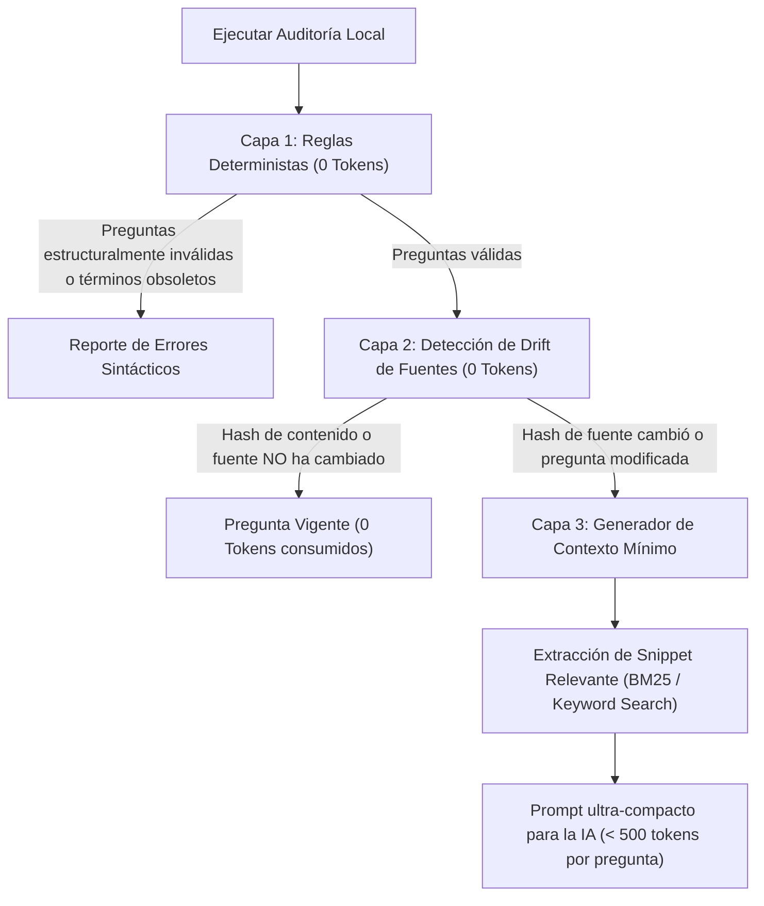

# Especificación Técnica: Sistema Estandarizado de Auditoría, Verificación y Scraping de Cuestionarios

## 1. Resumen Ejecutivo y Diagnóstico

### 1.1 Contexto
La plataforma de certificaciones cuenta con cuestionarios técnicos para múltiples certificaciones:
- **GitHub Copilot GH-300** (458 preguntas en `content/certifications/gh-300/balotarios.md`)
- **Anthropic Claude Certified Developer** (308 preguntas en `content/certifications/claude-certified-developer/balotarios.md`)
- Futuras certificaciones (ej. Azure AI, AWS Certified AI, Google Cloud AI, etc.).

Cada certificación implementó inicialmente una solución de auditoría/actualización independiente propuesta por su respectiva IA:
1. **Enfoque Claude (`verify_questions.py`)**:
   - **Fortaleza**: Máquina de estados incremental granular (`verification-state.json` y `source-hashes.json`). Registra `content_hash` de cada pregunta y `source_hash` de la página oficial. Detecta con precisión quirúrgica cuáles preguntas sufrieron cambios de contenido o de documentación oficial. Permite flujos CLI selectivos (`status`, `check-sources`, `mark 3:10-20`).
   - **Debilidad**: Hashea texto plano de HTML completo sin limpiar ruido (menús, footers, scripts dinámicos), generando falsos positivos de cambio. No almacena el texto descargado en local, no hace análisis estático determinista (validación de opciones A-Z, claves huérfanas, patrones obsoletos) y mantiene URLs y prefijos codificados directamente en Python.
2. **Enfoque Copilot (`audit_sources.py`)**:
   - **Fortaleza**: Motor de auditoría estática con reglas deterministas (valida opciones, claves, dominios permitidos, patrones de términos obsoletos, explicaciones genéricas y coincidencia léxica). Dispone de caché local (`source-cache/`) que almacena el texto normalizado y genera informes legibles (`audit-report.md`, `audit-report.json`). Cuenta con pruebas unitarias (`test_audit_sources.py`).
   - **Debilidad**: Proceso monolítico por lotes sin memoria incremental por pregunta. No sabe si una pregunta ya fue revisada y aprobada humanamente; cada ejecución audita todas las preguntas desde cero. No detecta si el contenido de una pregunta individual cambió respecto a su última verificación. Configuración (dominios y regex) acoplada en el código.

### 1.2 Objetivo de la Estandarización
1. **Unificar ambos enfoques en un motor centralizado y reutilizable**: Conservar la máquina de estados incremental de Claude junto con el motor de reglas deterministas, caché local e informes de Copilot.
2. **Arquitectura desacoplada y extensible**: Mantener el motor ejecutor en un script/módulo central (`scripts/audit_engine/` o `scripts/verify_certification.py`) y aislar toda la configuración específica de cada certificación (`audit-config.json`) en su respectivo directorio (`content/certifications/<cert-id>/`).
3. **Drástica reducción del consumo de tokens para la IA**: Evitar que un modelo LLM tenga que auditar preguntas ciegas o leer páginas enteras de documentación. El sistema debe filtrar localmente las preguntas que realmente necesitan revisión y extraer únicamente el fragmento documental relevante (snippet de 200–400 tokens) para la comprobación.
4. **Scraping inteligente y anti-ruido**: Normalizar el HTML aislando el contenedor semántico principal (`<main>`, `<article>`) para calcular hashes de verdad sobre el contenido técnico y no sobre cambios de banners, navegación o fechas en el footer.

---

## 2. Arquitectura del Sistema Estandarizado

### 2.1 Estructura de Directorios

```text
scripts/
├── cert_audit/                        # Motor agnóstico y reutilizable
│   ├── __init__.py
│   ├── config.py                      # Carga y validación de audit-config.json
│   ├── parser.py                      # Parser universal de balotarios.md
│   ├── scraper.py                     # Web scraper inteligente, extractor semántico y caché
│   ├── rules.py                       # Motor de auditoría determinista (opciones, dominios, regex)
│   ├── state.py                       # Gestor de verificación incremental (hashes y estados)
│   ├── context_builder.py             # Generador de contexto mínimo (Token Saver para IA)
│   └── reporter.py                    # Generador de reportes (Markdown y JSON)
└── verify_certification.py            # CLI unificada accesible desde la raíz

content/
└── certifications/
    ├── README.md                      # Guía maestra unificada de mantenimiento y auditoría
    └── <cert-id>/                     # Específico por certificación (ej: gh-300, claude-certified-developer)
        ├── audit-config.json          # Configuración declarativa (dominios, patrones, selectores, catálogo)
        ├── balotarios.md              # Fuente de verdad de preguntas
        ├── study-guide.md             # Guía de estudio oficial
        ├── verification-state.json    # Estado de verificación por pregunta (versionado en Git)
        ├── source-hashes.json         # Hashes semánticos de URLs oficiales (versionado en Git)
        ├── source-cache/              # Caché local de páginas descargadas (ignorado en Git salvo .gitignore)
        │   ├── .gitignore
        │   └── <url-hash>.json        # Texto limpio, metadatos y timestamp
        ├── audit-report.md            # Informe de hallazgos para humanos/agentes
        └── audit-report.json          # Datos estructurados exportados
```

---

## 3. Especificación de Configuración Declarativa (`audit-config.json`)

Cada certificación define su configuración sin tocar código Python.

### 3.1 Esquema JSON (`audit-config.json`)

```json
{
  "cert_id": "gh-300",
  "name": "GitHub Copilot GH-300",
  "source_file": "balotarios.md",
  "allowed_domains": [
    "docs.github.com",
    "github.com",
    "learn.microsoft.com",
    "code.visualstudio.com"
  ],
  "scraper": {
    "content_selectors": ["main", "article", "#main-content", ".content"],
    "strip_elements": ["nav", "header", "footer", "aside", "script", "style", "noscript", ".feedback-section"],
    "cache_ttl_days": 7,
    "timeout_seconds": 25,
    "user_agent": "Mozilla/5.0 (compatible; CertificationAuditor/1.0)"
  },
  "obsolete_patterns": [
    {
      "pattern": "(?i)\\bknowledge base\\b",
      "message": "Término obsoleto: Knowledge Base fue sustituido por Copilot Spaces",
      "severity": "medium"
    },
    {
      "pattern": "(?i)copilot\\.yaml",
      "message": "copilot.yaml no es el mecanismo oficial de exclusiones",
      "severity": "high"
    }
  ],
  "generic_patterns": [
    "en el contexto de esta pregunta",
    "coincide con el requisito",
    "las demás alternativas no son válidas"
  ],
  "official_sources_catalog": {
    "spaces": "https://docs.github.com/en/copilot/using-github-copilot/copilot-spaces",
    "content-exclusion": "https://docs.github.com/en/copilot/managing-copilot/managing-github-copilot-in-your-organization/configuring-content-exclusions-for-github-copilot"
  }
}
```

---

## 4. Estrategia de Web Scraping y Detección de Cambios Semánticos

### 4.1 Problema del Scraping Actual
El scraping ingenuo que hace `html.parser` o expresiones regulares sobre todo el HTML genera cambios en el hash por:
- Marcadores de tiempo ("Updated 3 hours ago") en el encabezado.
- Cambios de enlaces en el menú superior o pie de página.
- Anuncios, avisos de cookies y scripts de analítica.

Esto provoca **falsos positivos masivos**: 50 preguntas marcadas como "requieren revisión" cuando el texto de la documentación no cambió.

### 4.2 Solución: Extractor de Contenido Semántico (`scraper.py`)
1. **Aislamiento de Contenedores de Contenido**:
   - Analizar el DOM buscando los selectores prioritarios declarados en `scraper.content_selectors` (`<main>`, `<article>`, `#main-content`, `div[role="main"]`).
   - Si no se encuentra un contenedor explícito, usar `<body>`.
2. **Depuración de Ruido**:
   - Eliminar de raíz nodos `nav`, `header`, `footer`, `aside`, `script`, `style`, `noscript`, y elementos con clases típicas de comentarios, cookies o breadcrumbs.
3. **Normalización de Texto**:
   - Decodificar entidades HTML.
   - Colapsar espacios consecutivos, tabulaciones y saltos de línea repetidos.
   - Preservar encabezados (`#`, `##`) o formato Markdown básico si es factible para enriquecer las búsquedas posteriores.
4. **Cálculo de Hash Semántico**:
   - El hash SHA-256 se calcula **únicamente sobre el texto normalizado del contenedor principal**.
   - Solo un cambio en la documentación técnica real alterará el hash.
5. **Caché en Disco (`source-cache/<url-sha>.json`)**:
   - Estructura:
     ```json
     {
       "url": "https://docs.github.com/...",
       "final_url": "https://docs.github.com/...",
       "fetched_at": "2026-11-20T10:00:00Z",
       "status": "ok",
       "error": null,
       "sha256": "4a7b...",
       "clean_text": "Texto completo del contenido principal..."
     }
     ```
   - Si `cache_ttl_days` no ha expirado y no se solicita `--refresh`, se lee directo de disco (0 latencia, 0 ancho de banda).

---

## 5. Estrategia de Reducción de Tokens para IA (AI Assistance Engine)

El objetivo central es que cuando una IA (subagente o modelo) participe en la verificación de preguntas, consuma **el menor número posible de tokens**, pasando de decenas de miles a menos de 500 tokens por consulta.

### 5.1 Las 3 Capas de Filtrado



### 5.2 Generador de Contexto Mínimo (`context_builder.py`)
Cuando una pregunta requiere revisión humana o por IA (ejemplo: `verify_certification.py claude-certified-developer context 2:15`):
1. **No inyecta la página web entera (que puede tener 5.000 palabras)**.
2. Lee el `clean_text` de la fuente desde `source-cache/`.
3. Divide el texto en secciones o párrafos lógicos.
4. Aplica coincidencia léxica/semántica local (usando palabras clave de la pregunta + opción correcta + explicación) para seleccionar únicamente los **1 o 2 párrafos más relevantes** (máximo 250 palabras).
5. Produce una ficha estructurada lista para el prompt:

```markdown
### PREGUNTA A VERIFICAR [ID: claude-certified-developer-balotario-2-15]
- **Enunciado**: ¿Cuál es el límite máximo de tokens de salida para Claude 3.5 Sonnet?
- **Opciones**:
  A. 4.096 tokens
  B. 8.192 tokens
  C. 200.000 tokens
- **Respuesta registrada**: B
- **Explicación**: Claude 3.5 Sonnet soporta hasta 8.192 tokens de salida...
- **Motivo de revisión**: Fuente oficial modificada recientemente.

### EXTRACTO OFICIAL DE LA FUENTE (Párrafo relevante extraído):
> "...Claude 3.5 Sonnet now supports an expanded output limit of up to 8,192 tokens when using the anthropic-beta header..."
[Fuente: https://platform.claude.com/docs/en/api/overview]

### INSTRUCCIÓN PARA LA IA:
Determina si la respuesta registrada y su explicación continúan respaldadas por el extracto oficial. Responde en JSON: {"valid": true|false, "correction": "..."}
```

**Resultado medible**: En lugar de enviar un prompt de 8.000 tokens por pregunta, se envía un prompt de ~350 tokens. Para revisar un lote de 10 preguntas modificadas, se reduce el consumo de 80.000 a 3.500 tokens (ahorro superior al **95%**).

---

## 6. Interfaz de Línea de Comandos Unificada (CLI)

El ejecutable principal residirá en la raíz: `python3 scripts/verify_certification.py <cert-id> <comando> [opciones]`.

### 6.1 Comandos Disponibles

| Comando | Sintaxis | Descripción |
|---|---|---|
| `status` | `status [-b N] [--list]` | Muestra balance de preguntas verificadas vs. pendientes, agrupadas por motivo (sin verificar, contenido modificado, fuente modificada, error sintáctico). |
| `check-sources` | `check-sources [--refresh] [--catalog] [-b N]` | Descarga las fuentes oficiales de las preguntas, limpia el contenido, actualiza `source-hashes.json` y la caché local. |
| `audit` | `audit [--fail-on-review]` | Ejecuta todas las reglas deterministas locales (opciones A-Z, claves huérfanas, dominios, patrones obsoletos) y genera `audit-report.md` y `audit-report.json`. |
| `context` | `context <selector> [--format json\|md]` | Genera el contexto mínimo (< 500 tokens) con extracto de documentación para que la IA o el usuario verifiquen la pregunta sin gastar tokens. |
| `mark` | `mark <selector>... [--all] [--note "motivo"]` | Marca las preguntas seleccionadas como `verified`, registrando los hashes vigentes de contenido y de fuente. |
| `flag` | `flag <selector>... --note "motivo"` | Marca preguntas como `needs_review` para forzar su auditoría. |
| `diff-source` | `diff-source <selector>` | Si la fuente cambió, muestra el resumen de cambios del texto respecto a la versión previa. |

*Selectores admitidos*: `3` (todo el Balotario/Test 3), `3:12` (Test 3, Pregunta 12), `3:10-25` (Test 3, Preguntas 10 a 25), `--all` (todo el inventario).

---

## 7. Plan de Implementación para el Agente Programador

### Fase 1: Módulo Central `scripts/cert_audit/`
1. Crear el paquete en `scripts/cert_audit/`.
2. Implementar `parser.py`: lectura universal de `balotarios.md`, división por `Pregunta N`, extracción de enunciado, opciones A-Z, clave, explicación, y enlace markdown de fuente oficial.
3. Implementar `scraper.py`: descarga con `urllib`, extracción del contenedor principal con `HTMLParser`, eliminación de etiquetas no deseadas, normalización de espacios y guardado en `source-cache/`.
4. Implementar `rules.py`: migrar las validaciones deterministas de `audit_sources.py` (claves huérfanas, dominios permitidos, patrones obsoletos vía regex de configuración).
5. Implementar `state.py`: migrar la lógica de cálculo de `content_hash`, `source_hash`, comparación de estados y persistencia en `verification-state.json`.

### Fase 2: Reductor de Tokens (`context_builder.py`) y CLI
1. Desarrollar `context_builder.py` con algoritmo de búsqueda de fragmentos (segmentación de párrafos y scoring de intersección léxica/BM25).
2. Desarrollar `scripts/verify_certification.py` con `argparse` integrando todos los subcomandos (`status`, `check-sources`, `audit`, `context`, `mark`, `flag`).

### Fase 3: Configuración y Migración de Certificaciones Actuales
1. Crear `content/certifications/gh-300/audit-config.json` con los dominios de GitHub/Microsoft y los `OBSOLETE_PATTERNS`.
2. Crear `content/certifications/claude-certified-developer/audit-config.json` con los dominios de Anthropic, `OFFICIAL_SOURCES` y selectores de documentación.
3. Migrar el estado de verificación existente de Claude a la nueva convención y generar el estado inicial para GH-300.
4. Unificar el almacenamiento de caché en `source-cache/` dentro de cada carpeta de certificación.

### Fase 4: Pruebas Automatizadas y Documentación
1. Crear `tests/test_cert_audit.py` (pruebas unitarias para el parser, scraper, reglas, generador de contexto y CLI).
2. Actualizar los archivos `README-AUDITORIA.md` y `README-VERIFICACION.md` (o consolidar en una guía estandarizada `README-AUDITORIA.md` por certificación) explicando el flujo universal.
3. Actualizar `docs/context-map.md` para reflejar el nuevo pipeline de auditoría.

---

## 8. Criterios de Aceptación (Definición de Terminado)

- [ ] Un único script de entrada en `scripts/verify_certification.py` capaz de auditar tanto `gh-300` como `claude-certified-developer` sin código duplicado.
- [ ] Incorporación de una nueva certificación futura únicamente requiriendo su carpeta en `content/certifications/<nueva-id>/` con su `balotarios.md` y `audit-config.json`, sin modificar código fuente.
- [ ] Extractor de contenido semántico operativo que excluye elementos volátiles de HTML, reduciendo drásticamente los falsos positivos por cambios cosméticos.
- [ ] Subcomando `context` funcional que genera extractos documentales de menos de 500 tokens para evaluación asistida por IA.
- [ ] Todas las pruebas unitarias pasan con éxito con `bun test` o `python3 -m unittest`.
